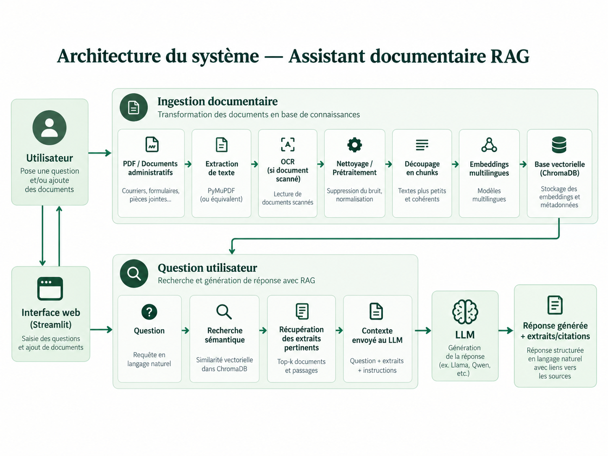
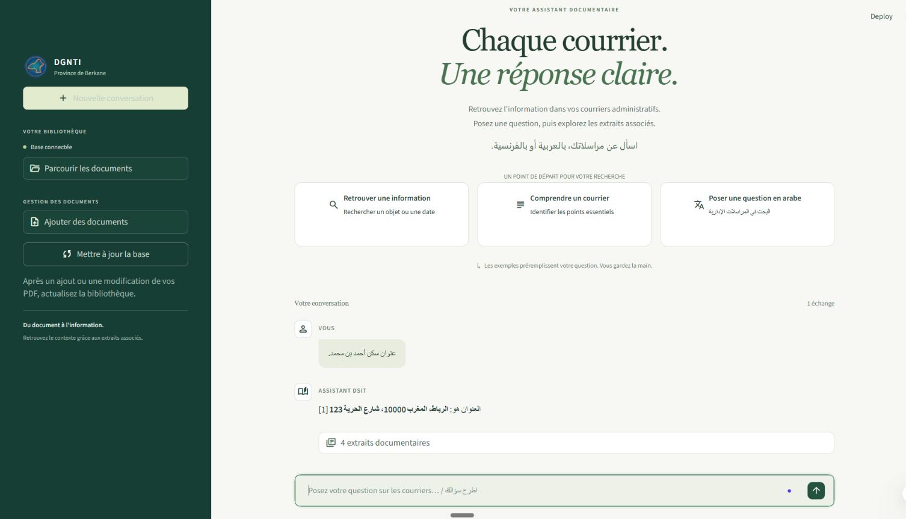

# RAG Assistant DGNTI — Présentation du projet

Ce dépôt est désormais un **dépôt de présentation** : il documente le projet RAG Assistant DGNTI, sans code source exécutable.

## Contexte et problématique

Le projet s’inscrit dans un besoin fréquent au sein d’environnements administratifs et académiques : retrouver rapidement des informations fiables dans un grand volume de documents PDF, parfois multilingues (français/arabe) et parfois scannés.

La difficulté principale est double :
- accéder rapidement à l’information pertinente ;
- conserver la traçabilité des réponses en s’appuyant sur des extraits de documents.

## Objectifs du projet

- Faciliter la consultation documentaire à partir de questions en langage naturel.
- Améliorer l’accès à l’information dans des corpus PDF hétérogènes.
- Fournir des réponses appuyées par des références explicites aux passages retrouvés.

## Fonctionnalités prévues / réalisées

Fonctionnalités prévues ou réalisées dans l’implémentation initiale du projet :
- ingestion et préparation de documents PDF ;
- OCR pour les pages scannées ;
- indexation sémantique des contenus ;
- recherche de passages pertinents ;
- génération de réponses contextualisées avec citations d’extraits.

## Architecture (description conceptuelle)

  

Architecture fonctionnelle (vue conceptuelle) :
1. **Collecte documentaire** : réception des PDF.
2. **Prétraitement** : extraction du texte et OCR si nécessaire.
3. **Structuration** : découpage en passages exploitables.
4. **Indexation vectorielle** : représentation sémantique des passages.
5. **Recherche** : récupération des extraits les plus pertinents pour une question.
6. **Génération de réponse** : formulation d’une réponse basée sur les extraits retrouvés.
7. **Restitution** : affichage de la réponse et des références associées.

## Technologies utilisées

Technologies mobilisées dans la version applicative initiale :
- interface web de démonstration ;
- traitement PDF et OCR ;
- embeddings multilingues ;
- base vectorielle ;
- modèle de génération de réponses.

> Ce dépôt ne fournit plus l’implémentation technique associée à ces composants.

## Flux de fonctionnement (sans code)

1. L’utilisateur soumet une question.
2. Le système recherche les passages les plus proches sémantiquement dans le corpus.
3. Les extraits retenus sont utilisés comme contexte de réponse.
4. Une réponse est restituée avec des références vers les extraits utiles.

## Cas d’utilisation (exemples)

- **Consultation de courriers administratifs** : retrouver rapidement les clauses ou informations demandées.
- **Appui à la lecture bilingue** : naviguer dans des documents français et arabes au sein d’un même corpus.
- **Préparation de synthèses** : accélérer l’identification des passages clés avant rédaction.

## Illustrations

### Interface

  

## Limites et perspectives

Limites identifiées :
- qualité variable selon la lisibilité des scans et la qualité OCR ;
- pertinence des réponses dépendante de la qualité des documents et du paramétrage de la recherche ;
- nécessité d’une évaluation systématique sur des jeux de cas réels.

Perspectives :
- enrichir le protocole d’évaluation (qualité de réponse, couverture, précision des citations) ;
- renforcer la gouvernance documentaire (qualité des sources, cycle de mise à jour) ;
- améliorer l’ergonomie pour des usages métiers spécifiques.

## Périmètre actuel du dépôt

Ce dépôt contient uniquement :
- la documentation de présentation du projet ;
- des illustrations (schémas/captures) dans `docs/images/`.

Il ne contient plus :
- code source exécutable ;
- scripts de lancement ou de configuration d’exécution ;
- dépendances applicatives ;
- artefacts techniques liés à l’exécution de l’assistant.
